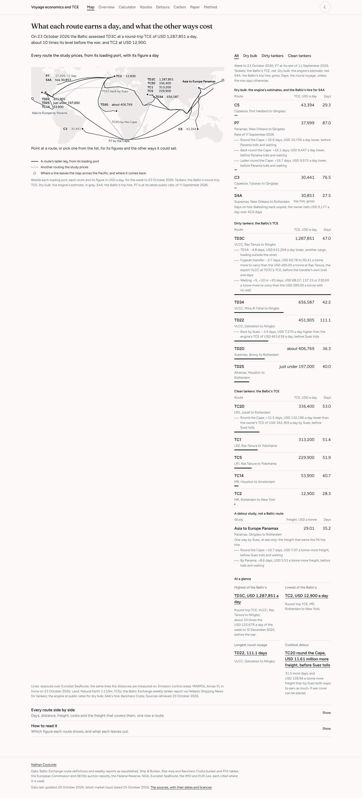
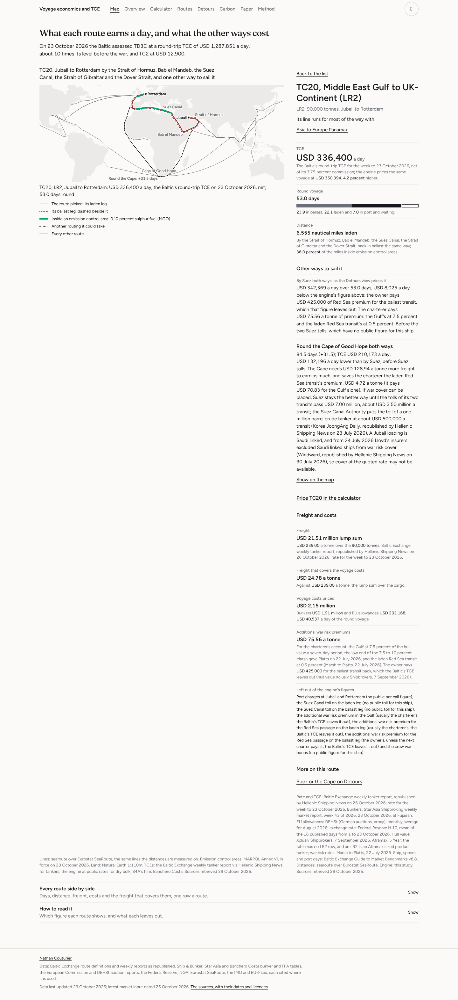
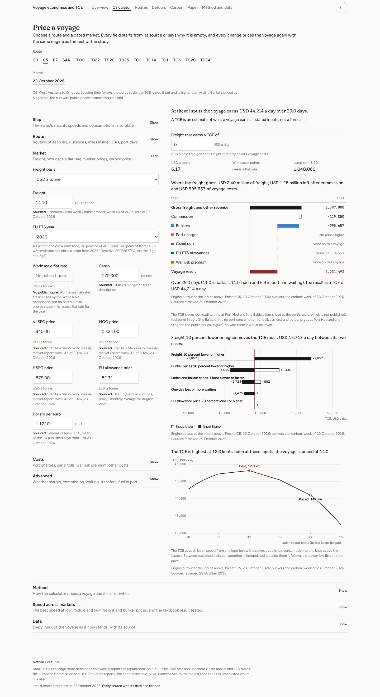
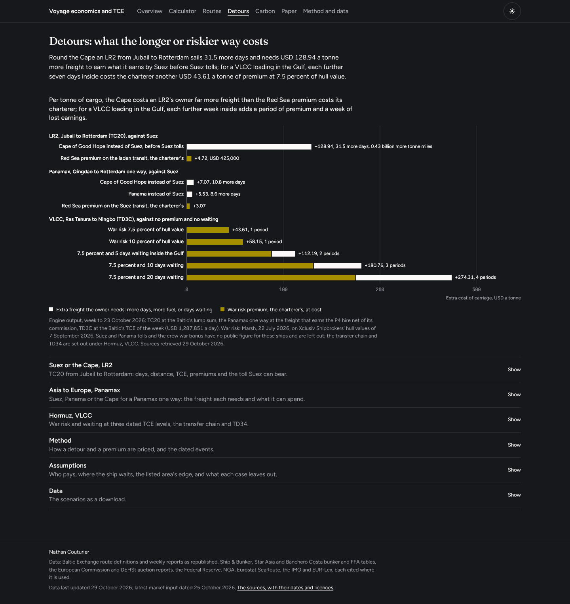

# Voyage economics and TCE

> Prices a dry bulk or tanker voyage on the Baltic Exchange's own routes, from
> dollar or Worldscale freight, bunkers by sulphur zone, port and canal costs,
> war risk premiums, EU allowances and the ballast leg, into a time charter
> equivalent, finds the freight a voyage needs, and sets the physical fixture
> against the FFA curve.

**Live site:** https://nathancouturier.github.io/voyage-tce-model/

**Research note:** [`Voyage-Economics-TCE-Research-Note.pdf`](Voyage-Economics-TCE-Research-Note.pdf), five pages.

For a given ship, route and market: what does the voyage earn a day, what
freight does it need, which costs decide the answer, and is fixing the cargo
physically better than hedging the same exposure on paper? The study answers
for the dry, dirty and clean routes the Baltic Exchange defines in its Guide to
Market Benchmarks v8.8 (September 2026), from public data only, and checks the
engine against every TCE the Baltic published that a public figure can price.

---

## What the study cannot do

Read this part first.

- **It forecasts nothing and trades nothing.** A TCE here is an estimate of
  what a voyage earns at stated inputs, dated, not a forecast. There is no
  signal, no position and no profit and loss. A TCE is compared with operating
  and capital costs, never net of them.
- **Every TCE leaves out port charges.** No public source states a per call
  figure for the study's ports and the Baltic's standard ships (the Baltic takes
  its port costs from Cory Brothers and says they are on its website, which
  answers scripted requests with a challenge), so the field is empty, counts as
  zero and the result names it. Each USD 100,000 of port charges is USD 1,307 a
  day on C3, USD 3,419 on C5 and USD 900 on TD22. They are one reason the engine
  reads above the Baltic's own TCE in the weeks it can be checked (2.6 to 4.5
  percent with bunker prices first printed that week, 1.8 to 4.7 percent with
  prices up to a week old; the two weeks after the closure of Hormuz read far
  above, and the week to 17 April 2026, priced with a Houston row first printed
  on 20 March, 1.4 percent below), but not the only one: the gap grows with
  freight, from USD 4,213 a day on TD22 at a USD 13.68 million lump sum (23
  January 2026) to USD 11,653 at USD 79.61 million (9 October 2026), which a
  fixed charge cannot do.
- **A rate in Worldscale points cannot be priced without the reader's flat
  rate.** Flat rates are licensed by the Worldscale Association and no public
  source states a study route's flat rate for 2025 or 2026, so the calculator
  takes the flat rate as an input with no default. One check is possible:
  Platts printed its Persian Gulf to China benchmark in points and in dollars
  together in January 2026, which implies USD 20.69 a tonne for its own route,
  whose ports it does not state. At that rate the Baltic's TD3C weeks of 2026
  read from 1.9 percent below to 10.9 percent above its TCE. The other 52
  Worldscale anchors are recorded as not reproducible rather than forced.
- **No fully worked voyage estimate with prices could be checked.** The
  training material that holds such examples could not be downloaded (the hosts
  are listed in [`data/AUDIT.md`](data/AUDIT.md)). The Baltic's own TD3C
  calculation of July 2017 is reproduced line by line, but it prints days and
  fuel and no prices, so no dollar figure is checked against a worked example.
- **Canal tolls are not computed.** Suez and Panama charge on each ship's own
  canal tonnage, which is not published for the Baltic's standard ships, and
  the Panama Canal Authority's tariff could not be reached. A routing through a
  canal leaves its toll out and says so; the detours report the toll each
  routing could bear instead. The guide's dry route terms set no time at a
  canal, so P7 also leaves out its Panama transit and any wait.
- **Bunker prices are dated public prices**: brokers' weekly tables and Ship &
  Bunker's monthly and quarterly averages, at four hubs (Singapore, Fujairah,
  Rotterdam, Houston), never a price a ship paid, and never a redistributed
  price history. Two brokers can print very different
  prices for the same day: for 6 March 2026 Intermodal's Houston VLSFO (USD
  689.30) stood 18 percent above Star Asia's (USD 584), which moves that week's
  TD22 comparison from 3.7 to 1.0 percent. Star Asia sometimes reprints a
  week's table unchanged, so a reprinted row is dated by its first printing. In
  the two weeks after Hormuz closed on 2 March 2026 the engine reads 17.3 and
  9.3 percent above the Baltic on TD22 with the tables of those weeks, and why
  is not established; TD3C, priced at Fujairah, shows no such jump, which points
  to TD22's Houston prices of those weeks or to the hub the Baltic priced TD22 at
  before its guide rewrote the fuel price text in May 2026 (v8.4).
- **Paper rests on Banchero Costa's weekly dry curves.** FFA levels are
  licensed; the study holds
  Banchero Costa's published Capesize, Panamax and Supramax assessments for
  weeks 27 and 43 of 2026 and its Capesize curve of week 26, whose vessel basis
  and dates are partly unstated, and the publisher printed the 29 June curve
  twice with different
  values (July USD 31,367, then 36,232), so the July basis is given on both
  prints. No public tanker FFA quote, and no C3 or C5 route FFA quote, in
  dollars a tonne was found: the Paper view takes a route FFA as an input and
  turns it into a TCE with the engine, and no tanker basis is computed; Drewry's
  February conversion of the TD3C curve is set beside the Baltic's later TCEs.
- **War risk premiums are priced by who pays them.** Additional premiums are
  usually the charterer's on spot voyage charters (Platts, 8 December 2025) and
  the Baltic's TCEs leave them out, so the study shows the charter's own
  premiums (its laden transits and its stay in the loading area, the ballast
  leg's days inside that area included) beside the owner's TCE. A ballast
  passage through another listed area on the way back, the Red Sea on TC20 by
  Suez, is the approach to the next loading and the owner's unless a charter
  puts it on the charterer (Gard, 21 March 2026), so it comes off the owner's
  TCE. Periods are seven days or part of them inside a listed area, counted from
  the days a voyage spends inside the Gulf, the area taken to end at the
  strait: a lower bound. The latest dated rates found are July 2026's.
- **The 5 percent weather margin on the dry routes is the study's choice.** The
  guide sets it for tanker TCEs (Appendix 3) and leaves a dry route's
  allowances to its panellists (section 7.4.2); without it the Capesize TCEs
  here read 6 to 11 percent higher.
- **The Baltic's tanker curves have two points.** Speed and consumption come as
  two pairs for each tanker, so the power law fitted to them is flat (laden
  exponents of 1.5 to 2.3, against the 3 of the textbook) and at 2026 freight
  the best tanker speed sits at the top of the range searched except at the
  lowest freight; the curves cannot say whether that speed is reachable.
- **The allowance price after June 2025 is a proxy**: DEHSt's monthly average
  of Germany's auctions on EEX, which sat EUR 0.25 a tonne above the common
  auction platform's on average over the 30 months both cover here, January
  2023 to June 2025 (from 1.58 below to 1.67 above).
- **The body face is not the portfolio's.** The portfolio sets Satoshi, whose
  licence forbids serving it from a repository; this site sets Figtree, the
  openly licensed face closest to it.

## What it does

- **A voyage engine that follows the Baltic's conventions.** The TCE is gross
  freight and other revenue, less commission and voyage costs, over the days
  of the whole round voyage, the ballast leg included, with the tanker method
  of the guide's Appendix 3: a 5 percent weather margin, the round voyage from
  the discharge port, the route's port and waiting days, and bunkers at the hub
  nearest the load port (C3 at Singapore, about 270 nm off its ballast leg).
  Freight in
  dollars a tonne, Worldscale points with a flat rate, a lump sum, or hire on a
  trip charter; commission at 5 percent on dry routes and 3.75 percent on
  tankers, address commission and brokerage together.
- **Every voyage cost a desk prices.** Bunkers by grade and zone, MGO inside
  emission control areas measured on the route line against polygons built from
  MARPOL Annex VI Appendix VII, with the Mediterranean ECA from 1 May 2025; EU
  allowances by coverage (50 percent into or out of the EEA, 100 percent
  between EEA ports and within a port of call) and phase in (40, 70 and 100
  percent for 2024, 2025 and 2026), with methane and nitrous oxide from 2026;
  FuelEU Maritime's penalty for one voyage's share, shown and kept out of the
  TCE; war risk premiums as a share of hull value for each seven days or part
  of them inside a listed area, the charter's shown beside the owner's TCE and
  a ballast passage through another area in the owner's costs; port and canal
  costs as dated lump sums where a public source exists.
- **The freight a voyage needs** for any target TCE, in dollars a tonne,
  Worldscale points and a lump sum; the speed that maximises the TCE on a 0.01
  knot grid, consumption interpolated between published pairs and extended by
  a fitted power law outside them; and the sensitivities of the TCE to each
  input.
- **Fourteen routes and three detours.** C3, C5, P7 and S4A for dry bulk; TD3C,
  TD22, TD20, TD25 and TD34 for dirty tankers; TC2, TC14, TC1, TC5 and TC20 for
  clean; with TC23 for the intra-EEA carbon case and the P4 trip's hire as the
  Panamax detour's target. The detours: Suez or the Cape for an LR2 on TC20;
  Suez, Panama or the Cape for a Panamax one way from Qingdao to Rotterdam; and
  Hormuz for a VLCC on TD3C, war risk and waiting inside the Gulf, with the
  transfer chain off Fujairah and the Baltic's Gulf of Oman route (TD34) set
  beside them. In the calculator a route with another routing (round the Cape
  instead of Suez, say) can be priced on it, with the inputs that change and
  their sources.
- **Physical against paper.** Each anchor week's voyage TCE, grossed up by its
  commission as the guide does before setting a voyage against time charter
  rates, against the 5TC FFA over the voyage's days (each day at its month's
  FFA, on the latest curve tradable on the fixture date), the freight that
  would earn the FFA, the hedge in 5TC days by month or route FFA tonnes, and
  the basis and timing basis.
- **Validation in the open.** The Baltic's TD22 and TC20 lump sums priced in 13
  weeks against its published TCEs; its TD3C weeks of 2026 at the flat rate
  Platts' January prints imply; its own TD3C calculation of July 2017
  reproduced line by line for days and fuel; early March 2026 rates priced
  through the engine; the dry weeks against the Capesize and Panamax 5TC; 25
  distances checked against NGA Pub. 151.
- **A calculator that is the engine.** `src/engine.js` mirrors
  `src/voyage/engine.py` and is held to it within one part in a billion on 295
  cases, every anchor among them; every input starts from its source or says
  why it is empty.

---

## The site



Eight views, each opening on its key chart and a one sentence takeaway, with
method, assumptions and data behind buttons. **Map**, where the site opens:
every route the study prices on one map of the world, each loading area
labelled with its routes and their TCEs, the other routings the study prices
dotted, and beside the map the list of routes with their TCE and round voyage
days, each other routing a line under its route with what it changes against
its base, the base named with its figure and unit where the row shows
another. A route picked on the map or in the list is framed on the map with
its ballast leg, its emission control stretches and its other routings, each
named with its days, while the column beside it gives its figures and what
each other way would cost; the address keeps the choice, and Back closes the
route in one step. **Overview**,
the featured voyage at the latest anchor, its bridge from freight to TCE and
its map; **Calculator**, every input in five steps; **Routes**; **Detours**;
**Carbon**; **Paper**; and **Method**, every convention with the text it is
read from, the formulas, the validation table, the sources and the downloads.
Screenshots of the views are in [`assets/`](assets/); the build checks every
view at 1440, 768, 390 and 320 pixels in both themes.

TC20 picked on the Map: its line by Suez in the accent colour, its ballast
leg dashed beside it, and the routing round the Cape dotted and named with
its 31.5 more days. Beside the map, its entry gives the Cape's TCE, USD
132,196 a day lower than the owner's TCE by Suez, before Suez tolls; Suez
stays the better way, if war cover can be placed, until the tolls of its two
transits pass USD 7.00 million.



The calculator, on C5 at the week to 23 October 2026, with the Market step
open: every field says where its figure comes from, or why it is empty.



Detours, in the dark theme: what a tonne of cargo costs more when a voyage
goes round the Cape, pays a war risk premium or waits inside the Gulf, split
into the owner's freight and the charterer's premium.



---

## Running it locally

There is no build step, no framework and no install for the site: plain HTML,
ES modules and CSS reading JSON out of `data/`.

```bash
git clone https://github.com/nathancouturier/voyage-tce-model.git
```

```bash
cd voyage-tce-model
```

```bash
python scripts/serve.py --port 8150
```

Then open **http://localhost:8150/voyage-tce-model/**, with the subpath and the
trailing slash. `scripts/serve.py` uses the standard library only and serves
the repository at the subpath the live site uses, answering 404 everywhere
else, so a path that would break the deploy breaks here first.

For the pipeline and the checks, install the pinned dependencies once (Python
3.11.5 or later: the lock pins the versions the committed files were built
with on Python 3.13, and on Python 3.11 the same pins rebuild every file byte
for byte), then run the gate:

```bash
make setup
```

```bash
make all
```

`make all` rebuilds every derived file from the committed data (the Baltic
seed from its module, the engine's test cases, the JSON and CSV files the site
reads, the content hashes in `index.html` and the research note), runs the
gate, and then fails if a rebuilt seed, test case, site file or content hash
differs from the commit or a new file appears beside them. The note is rebuilt
but not compared, since its bytes depend on the fonts installed. `make gate`
runs the checks alone; `make help` prints the command or commands each target
runs, for a machine without `make` (the steps of `all` and `gate` are in the
Makefile). The note is set in the Liberation fonts, read from
`/usr/share/fonts/truetype/liberation` (on Debian and Ubuntu,
`apt install fonts-liberation`).

| Command | What it does |
|---|---|
| `python scripts/refresh.py --offline` | Checks the committed caches against their rules and their raw files, no network. |
| `python scripts/seeds.py --check` | The Baltic seed against `src/voyage/baltic.py`, where every figure carries its page in the guide. |
| `python scripts/gen_fixtures.py --check` | The engine's 295 parity cases against the Python engine. |
| `python -m pytest tests` | Formulas with hand checked numbers, the ETS phase in boundaries, the Mediterranean ECA start, Worldscale, war risk periods and payers, the anchors, every Pub. 151 figure found on its page, the allowance proxy's gap, the note; and every seed quote found in its document where the licensed documents are on disk (a clean clone skips that test). |
| `python scripts/export.py --check` | Every JSON file and CSV the site reads, and the content hashes in `index.html`, against a rebuild. |
| `node tools/validate-data.mjs` | Every cited document in the raw manifest, every committed file at its hash, caches running forward. |
| `node tools/validate-engine.mjs` | `src/engine.js` against the Python, case by case, to 1e-9. |
| `node tools/validate-artifacts.mjs` | Every artifact against what the page reads from it. |
| `node tools/check-paths.mjs` | Every path relative, so the subpath deploy works. |
| `node tools/check-literals.mjs` | No number in the frontend that no artifact supplied. |
| `node tools/check-styles.mjs` | The stylesheets against the portfolio's design system. |
| `node tools/check-dashes.mjs` | No em dash or en dash anywhere in the repository. |

Two more need a browser and the local server, so they sit beside the gate:
`make browser` runs `tools/check-site.mjs`, which draws every view at 1440 and
320 pixels, takes the Map through its picks, history, focus and drawing and
through a finger's taps and the mouse's moves and clicks, and drives the calculator's
form against the engine, and `make site` writes the README's screenshots into
`assets/`. The build workflow runs the
browser check on every push to `main` and every pull request, then every view
at four widths in both themes,
closed and with every section open. `make note` writes the research note again
from the committed data.

---

## Refreshing the data

```bash
python scripts/refresh.py
```

Two inputs are series a script can follow: the EU allowance price (the
European Commission's auction reports to June 2025, then DEHSt's German
auctions) and the Federal Reserve's H.10 dollar rate. `refresh.py` fetches
both, checks them and rebuilds the artifacts; `.github/workflows/refresh.yml`
runs it on the 8th of each month, rebuilds the engine's test cases, runs the
gate, and commits and publishes only when an observation is new or revised and
everything passes, opening an issue if anything fails.

Every other input is a dated figure read from a cited document into
`data/seed/`, with the passage it was read from: a new bunker average, freight
report or FFA assessment is a new document to read, not a download to repeat.
A dated market reads no price from after its date: bunkers from the brokers'
table of the week or of up to seven days before, a reprinted row dated by its
first printing; the allowance price of the latest month before the voyage's
own; and the dollar rate averaged over the voyage's month up to its date. The
August 2026 common market is a period average instead: Ship & Bunker's August
averages where it publishes them (Singapore VLSFO and HSFO; Fujairah VLSFO) and
its third quarter averages, July to September, for the other hub prices, with
the allowance price and the dollar rate of August.

---

## Provenance

| Input | Publisher | Terms | In this repository |
|---|---|---|---|
| Routes, vessels, speed and consumption pairs, TCE method, FFA settlement units (bulk carrier speeds are the study's choice of the pairs printed) | Baltic Exchange, Guide to Market Benchmarks v8.8 (September 2026); TD3C TCE calculation process (July 2017) | Baltic copyright | figures with their page in `src/voyage/baltic.py`; the documents are not committed |
| Weekly tanker rates and TCEs, December 2025 to October 2026 | Baltic Exchange weekly tanker reports, as republished by Hellenic Shipping News; Platts, Argus and Oilprice for the Gulf to China rates in dollars a tonne | publishers' terms | figures with links, `data/seed/anchors.json` |
| Bunker prices | Ship & Bunker monthly analyses and quarterly tables; Star Asia Shipbroking and Banchero Costa weekly tables; Intermodal as a cross-check | publishers' terms | figures with links, `data/seed/market.json` |
| Dry freight, FFA assessments and fixtures, FFA settlement rules | Signal Group, Banchero Costa and Drewry, as republished by Hellenic Shipping News; EEX and ICE contract rules | publishers' terms | figures with links, `data/seed/anchors.json`, `data/seed/ffa.json` |
| War risk premiums, who pays them, the Hormuz shuttle, hull values, crew bonus, events | Marsh, S&P Global Platts, Gard, Windward, Kpler and The Wall Street Journal as republished; Xclusiv Shipbrokers for hull values and Signal Group for the early March VLCC value; the ITF and JNG statement; EIA | publishers' terms; EIA public domain | figures with links, `data/seed/market.json`, `data/seed/events.json`, `data/seed/conventions.json` |
| EU allowance price, monthly | European Commission auction reports; DEHSt German auctions, through the sibling study's cache | CC BY 4.0; CC BY-NC-ND 4.0 | yes, `data/cache/eua_monthly.csv` |
| US dollars per euro, daily | Federal Reserve Board, H.10 | US public domain | yes, `data/cache/usd_per_eur_daily.csv` |
| Port positions | NGA World Port Index (Pub. 150) | US public domain | yes |
| Published distances | NGA Distances Between Ports (Pub. 151, 2001) | US public domain | yes |
| Sea routes and distances | searoute 1.6.0 over Eurostat's SeaRoute network | Apache 2.0; EUPL 1.2 | results, `data/seed/sea_routes.*` |
| Emission control areas | IMO, MARPOL Annex VI Appendix VII (MEPC.328(76)), MEPC.361(79), MEPC.392(82) | IMO documents, cited | polygons, `data/seed/eca.json` |
| Emission factors, EU ETS, FuelEU, time charter allocation | EUR-Lex; IMO; BIMCO | as published | quotes with their article, `data/seed/conventions.json` |
| Canal tolls | Suez Canal Authority circulars and statements; EIA | as published | `data/seed/canals.json` |

`data/raw/manifest.json` records every one of the 365 documents read, with
its URL, retrieval time, sha256 and licence. Four public ones are committed
(the World Port Index, Pub. 151, one Commission auction report and the DEHSt
months); the other public files are kept outside git as the record and can be
fetched again from their URL, and licensed documents are cited, never
redistributed.
[`data/AUDIT.md`](data/AUDIT.md) gives each source's endpoint, coverage, units,
terms and a sample, every input left empty with the reason, and the hosts that
could not be reached.

---

## Known limitations

- **Distances are searoute's**, not the Baltic's AtoBviaC: 20 of 25 port pairs
  fall within 2 percent of NGA Pub. 151, Galveston to Shanghai round the Cape and
  through the Sunda Strait (the routing of TD22's ballast leg) among them (0.0
  percent; TD22's laden leg through Malacca has no Pub. 151 figure of its own);
  the largest misses are Port Hedland to Busan (+4.2 percent), Ras Tanura to the
  Cape of Good Hope (+3.6) and Amsterdam to Le Havre (+3.0).
  Each line starts at the network's node nearest its port. Amsterdam's nearest
  node lies in the IJmeer, behind the lakes, so its legs are routed from
  IJmuiden with the 14 miles of the North Sea Canal that Pub. 151 prints (page
  44); the stretch from the port is added at Port Hedland (43 nm) and Jubail
  (12 nm) and left out elsewhere (about 21.5 nm a leg at Tubarao).
- **TD22's laden leg goes through the Strait of Malacca**, the strait the
  Baltic's own TD3C calculation for the same laden ship implies (its 5,897 nm
  for the Gulf to China leg, July 2017, against the network's 5,849 nm through
  Malacca), not through the shallower Sunda Strait of the network's shortest
  line, which is 176.6 miles shorter and which the ballast leg takes. The guide
  itself names no strait for TD22.
- **TD25 is priced on the Baltic's Aframax of 115,000 tonnes.** Its TCE
  description names an AFRA105 the guide never describes.
- **Dry laytime becomes calendar days by rule**: Saturdays and Sundays excepted
  terms count five working days in seven, holidays ignored; Capesize loading at
  the port's own scale has no published rate and is left out, as is fuel burnt
  in port by bulk carriers, for which the guide prints none.
- **The S4A trip runs 27.5 days**, the middle of the Baltic's 25 to 30, and the
  owner's TCE counts the ballast back to the US Gulf, as the guide counts a time
  charter's ballast time (section 7.4.3); the trip's own hire net of commission
  is shown beside it.
- **Bulk carrier speeds are the study's choice**: the dry route terms name no
  speed, so the study takes the fastest pair the guide prints for each ship,
  labelled as its choice; the calculator gives the TCE at every speed.
- **The week 27 spot 5TC, USD 33,678, is the 180,000 t basis**, as the BCI and
  BDI printed that day show: the 182,000 t ship is set against USD 37,181. The
  July FFA curve does not state its basis and is printed one trading day after
  the physical rates, so the voyage is set against the curve of 29 June, on
  both of the publisher's prints of it.
- **A ship to ship transfer's own cost has no public figure**; the shuttle
  through Hormuz was reported at USD 16 to 20 a barrel and USD 50 million a
  transit, figures set beside the export voyage, not priced into it.
- **Commission is one input**, address commission and brokerage together: only
  the total moves the TCE, the Baltic quotes totals, and no public source gives
  a typical split.
- **The map is drawn on Natural Earth's 1:110m land**, coarse at the scale of a
  strait; the distances come from the route lines, not the map.

---

## Layout

```
index.html                       the page; eight views behind a hash router
src/*.js                         the views, the browser engine (engine.js) and their helpers
src/voyage/                      the Python package: engine, cases, anchors, analysis, export, maps, words
src/voyage/sources/              the adapters: the Baltic guide, EU allowances, the dollar rate, IMO texts,
                                 NGA ports and distances, and the raw manifest (base)
styles/                          the portfolio's tokens, layout and components, and this study's data palette
data/seed/                       every dated figure read by hand, with its document and passage
data/cache/                      the two series a script refreshes
data/raw/                        the raw manifest and the documents whose terms allow committing them
data/fixtures/                   the engine's parity cases
data/*.json, data/downloads/     what the site reads and offers, written by scripts/export.py
data/AUDIT.md                    every source probed: endpoint, coverage, units, terms, sample
scripts/                         refresh, seeds, routes, eca, export, fixtures, note, serve, screenshots
tools/                           the gate's validators and the browser checks
tests/                           the pytest suite
docs/design.md                   the design notes and the data palette, with contrast in both themes
docs/methodology.md              the rules a voyage is built by, each with its source
vendor/                          fonts and land outlines, with their licences
assets/                          screenshots
.github/workflows/               build (gate, browser, Pages) and the monthly refresh
```

## Licence

The code, and the figures this study computes itself, are under the MIT
licence in [`LICENSE`](LICENSE). Data published by others keep their
publishers' terms, set out in [`NOTICE`](NOTICE): the EU allowance months from
DEHSt are under CC BY-NC-ND 4.0 and reproduced unchanged, the route lines are a
work derived from Eurostat's SeaRoute network (EUPL 1.2), and the fonts and
land outlines in `vendor/` carry their own licences beside them.

Author: [Nathan Couturier](https://nathancouturier.github.io).
