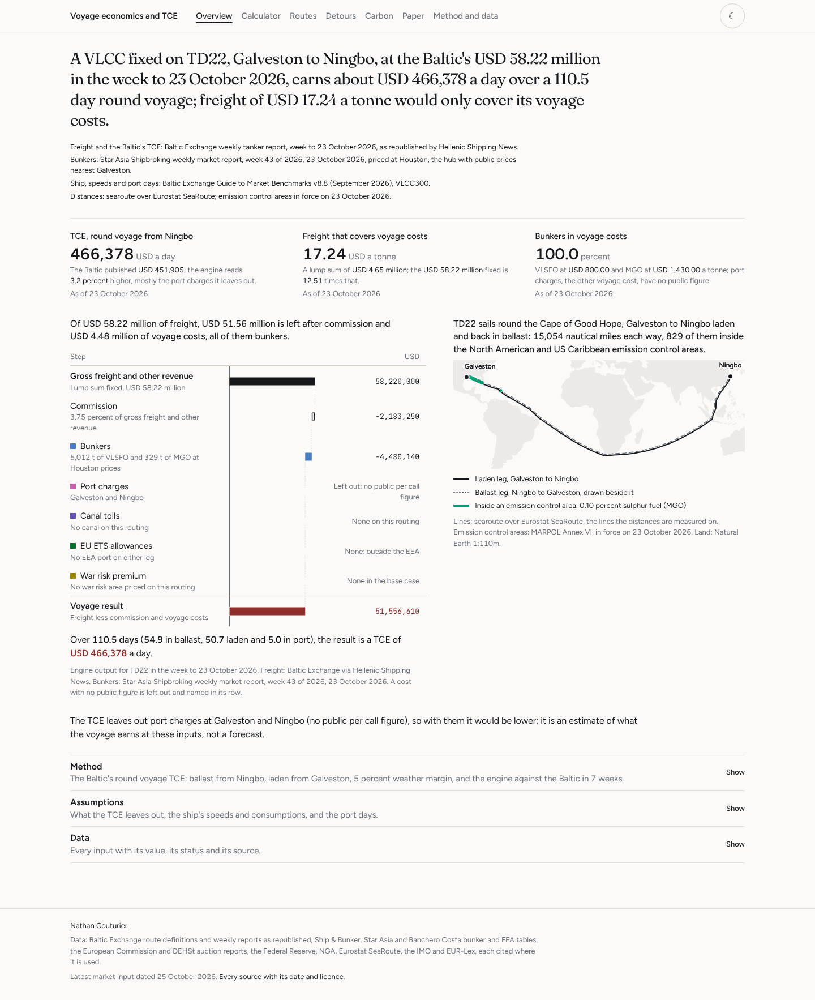

# Voyage economics and TCE

> Prices a dry bulk or tanker voyage on the Baltic Exchange's own routes, from
> dollar or Worldscale freight, bunkers by sulphur zone, port and canal costs,
> war risk premiums, EU allowances and the ballast leg, into a time charter
> equivalent, finds the freight a voyage needs, and sets the physical fixture
> against the FFA curve.

**Live site:** https://nathancouturier.github.io/voyage-tce-model/

**Research note:** [`Voyage-Economics-TCE-Research-Note.pdf`](Voyage-Economics-TCE-Research-Note.pdf), five pages.

For a given ship, route and market: what does the voyage earn a day, what
freight does it need, which costs decide the answer, and is fixing the cargo
physically better than hedging the same exposure on paper? The study answers
for the dry, dirty and clean routes the Baltic Exchange defines in its Guide to
Market Benchmarks v8.8 (September 2026), from public data only, and checks the
engine against every TCE the Baltic published that a public figure can
reproduce.

---

## What the study cannot do

Read this part first.

- **It forecasts nothing and trades nothing.** A TCE here is an estimate of
  what a voyage earns at stated inputs, dated, not a forecast. There is no
  signal, no position and no profit and loss. A TCE is compared with operating
  and capital costs, never net of them.
- **Every TCE leaves out port charges.** No study port publishes a per call
  figure for the Baltic's standard ships (the Baltic itself uses Cory Brothers'
  estimates, which are not published), so the field is empty, counts as zero
  and the result names it. Each USD 100,000 of port charges is USD 1,307 a day
  on C3 and USD 3,450 a day on C5. This is why the engine reads 2.4 to 5.3
  percent above the Baltic's own TCE in the weeks it can be checked, one week
  aside (below).
- **A rate in Worldscale points cannot be priced without the reader's flat
  rate.** Flat rates are licensed by the Worldscale Association and no public
  source states a route's flat rate for 2025 or 2026. The calculator takes the
  flat rate as an input with no default, and the 64 Worldscale anchors are
  recorded as not reproducible rather than forced.
- **Canal tolls are not computed.** Suez and Panama charge on each ship's own
  canal tonnage, which is not published for the Baltic's standard ships, and
  the Panama Canal Authority's tariff could not be reached. A routing through a
  canal leaves its toll out and says so; the detours report the toll each
  routing could bear instead.
- **Bunker prices are dated public averages**, monthly or weekly, at four hubs
  (Singapore, Fujairah, Rotterdam, Houston), never a price a ship paid, and
  never a redistributed price history. In the week Hormuz closed they moved
  faster than any weekly table: priced with the table of the week before, the
  week to 13 March 2026 reads 23.6 percent above the Baltic.
- **Paper is two public dry curves.** FFA levels are licensed; the study holds
  Banchero Costa's published Capesize, Panamax and Supramax assessments for
  weeks 27 and 43 of 2026. No public tanker FFA quote in dollars a tonne was
  found, so the tanker comparison uses Drewry's published TCE conversion of the
  TD3C curve.
- **The Baltic's tanker curves have two points.** Speed and consumption come as
  two pairs for each tanker, so the power law fitted to them is flat (laden
  exponents of 1.5 to 2.3, against the 3 of the textbook) and at 2026 freight
  the best tanker speed sits at the top of the range searched; the curves
  cannot say whether that speed is reachable.
- **The allowance price after June 2025 is a proxy**: DEHSt's monthly average
  of Germany's auctions on EEX, 0.13 EUR a tonne above the common auction
  platform's on average over January 2013 to June 2025.
- **The body face is not the portfolio's.** The portfolio sets Satoshi, whose
  licence forbids serving it from a repository; this site sets Figtree, the
  openly licensed face closest to it.

## What it does

- **A voyage engine that follows the Baltic's conventions.** The TCE is gross
  freight and other revenue, less commission and voyage costs, over the days
  of the whole round voyage, the ballast leg included, with the tanker method
  of the guide's Appendix 3: a 5 percent weather margin, the round voyage from
  the discharge port, the route's port and waiting days, and bunkers at the hub
  nearest the load port. Freight in dollars a tonne, Worldscale points with a
  flat rate, a lump sum, or hire on a trip charter; commission at 5 percent on
  dry routes and 3.75 percent on tankers.
- **Every voyage cost the brief names.** Bunkers by grade and zone, MGO inside
  emission control areas measured on the route line against polygons built from
  MARPOL Annex VI Appendix VII, with the Mediterranean ECA from 1 May 2025; EU
  allowances by coverage (50 percent into or out of the EEA, 100 percent
  between EEA ports and at berth) and phase in (40, 70 and 100 percent for
  2024, 2025 and 2026), with methane and nitrous oxide from 2026; FuelEU
  Maritime's penalty for one voyage's share, shown and kept out of the TCE;
  war risk premiums as a share of hull value per transit; port and canal costs
  as dated lump sums where a public source exists.
- **The freight a voyage needs** for any target TCE, in dollars a tonne,
  Worldscale points and a lump sum; the speed that maximises the TCE on a 0.01
  knot grid, consumption interpolated between published pairs and extended by
  a fitted power law outside them; and the sensitivities of the TCE to each
  input.
- **Fourteen routes and the detours that matter in 2026.** C3, C5, P7 and S4A
  for dry bulk; TD3C, TD22, TD20, TD25 and TD34 for dirty tankers; TC2, TC14,
  TC1, TC5 and TC20 for clean. Suez against the Cape for an LR2 and a Panamax
  from Asia to Europe, and the Hormuz scenarios for a VLCC: war risk, waiting,
  a ship to ship transfer off Fujairah and the Baltic's Gulf of Oman route.
- **Physical against paper.** Each anchor week's voyage TCE against the 5TC FFA
  for the voyage month, the freight that would earn the FFA, the hedge in 5TC
  days or route FFA tonnes, and the basis and timing basis.
- **Validation in the open.** The Baltic's TD22 and TC20 lump sums priced week by
  week against its published TCEs; its own worked TD3C calculation of July 2017
  reproduced line by line; early March 2026 rates priced through the engine;
  distances checked against NGA Pub. 151.
- **A calculator that is the engine.** `src/engine.js` mirrors
  `src/voyage/engine.py` and is held to it within one part in a billion on 275
  cases, every anchor among them; every input starts from its source or says
  why it is empty.

---

## The site



Seven views, each opening on its key chart and a one sentence takeaway, with
method, assumptions and data behind buttons: **Overview**, the featured voyage
at the latest anchor, its bridge from freight to TCE and its map;
**Calculator**, every input in five steps; **Routes**; **Detours**; **Carbon**;
**Paper**; and **Method and data**, every convention with the text it is read
from, the formulas, the validation table, the sources and the downloads.
Screenshots of the views are in [`assets/`](assets/); the build checks every
view at 1440, 768, 390 and 320 pixels in both themes.

---

## Running it locally

There is no build step, no framework and no install for the site: plain HTML,
ES modules and CSS reading JSON out of `data/`.

```bash
git clone https://github.com/nathancouturier/voyage-tce-model.git
```

```bash
cd voyage-tce-model
```

```bash
python scripts/serve.py --port 8150
```

Then open **http://localhost:8150/voyage-tce-model/**, with the subpath and the
trailing slash. `scripts/serve.py` uses the standard library only and serves
the repository at the subpath the live site uses, answering 404 everywhere
else, so a path that would break the deploy breaks here first.

For the pipeline and the checks, install the pinned dependencies once (Python
3.11 or later; the lock is Python 3.13's), then run the gate:

```bash
make setup
```

```bash
make all
```

`make all` rebuilds every derived file from the committed data (the Baltic
seed from its module, the engine's test cases, the JSON and CSV files the site
reads, the content hashes in `index.html` and the research note) and then runs
the gate, which fails if any rebuilt byte differs from the commit. `make gate`
runs the checks alone; `make help` prints each target as the single command it
stands for, for a machine without `make`.

| Command | What it does |
|---|---|
| `python scripts/refresh.py --offline` | Checks the committed caches against their rules and their raw files, no network. |
| `python scripts/seeds.py --check` | The Baltic seed against `src/voyage/baltic.py`, where every figure carries its page in the guide. |
| `python scripts/gen_fixtures.py --check` | The engine's 275 parity cases against the Python engine. |
| `python -m pytest tests` | Formulas with hand checked numbers, the ETS phase in boundaries, the Mediterranean ECA start, Worldscale, the anchors, every seed quote found in its document, the note. |
| `python scripts/export.py --check` | Every JSON file and CSV the site reads, and the content hashes in `index.html`, against a rebuild. |
| `node tools/validate-data.mjs` | Every cited document in the raw manifest, every committed file at its hash, caches running forward. |
| `node tools/validate-engine.mjs` | `src/engine.js` against the Python, case by case, to 1e-9. |
| `node tools/validate-artifacts.mjs` | Every artifact against what the page reads from it. |
| `node tools/check-paths.mjs` | Every path relative, so the subpath deploy works. |
| `node tools/check-literals.mjs` | No number in the frontend that no artifact supplied. |
| `node tools/check-styles.mjs` | The stylesheets against the portfolio's design system. |
| `node tools/check-dashes.mjs` | No em dash or en dash anywhere in the repository. |

Two more need a browser and the local server, so they sit beside the gate:
`make browser` runs `tools/check-site.mjs`, which draws every view at 1440 and
320 pixels and drives the calculator's form against the engine, and `make site`
writes the README's screenshots into `assets/`. The build workflow runs the
browser check on every push, then every view at four widths in both themes,
closed and with every section open. `make note` writes the research note again
from the committed data.

---

## Refreshing the data

```bash
python scripts/refresh.py
```

Two inputs are series a script can follow: the EU allowance price (the
European Commission's auction reports to June 2025, then DEHSt's German
auctions) and the Federal Reserve's H.10 dollar rate. `refresh.py` fetches
both, checks them and rebuilds the artifacts; `.github/workflows/refresh.yml`
runs it on the 8th of each month, rebuilds the engine's test cases, runs the
gate, and commits and publishes only when an observation is new or revised and
everything passes, opening an issue if anything fails.

Every other input is a dated figure read from a cited document into
`data/seed/`, with the passage it was read from: a new bunker average, freight
report or FFA assessment is a new document to read, not a download to repeat.
A dated market reads no price from after its date: bunkers from the brokers'
table of the week, the allowance price of the latest month before the
voyage's own, and the dollar rate averaged over the voyage's month up to its
date.

---

## Provenance

| Input | Publisher | Terms | In this repository |
|---|---|---|---|
| Routes, vessels, speeds and consumptions, TCE method, FFA settlement units | Baltic Exchange, Guide to Market Benchmarks v8.8 (September 2026); TD3C TCE calculation process (July 2017) | Baltic copyright | figures with their page in `src/voyage/baltic.py`; the documents are not committed |
| Weekly tanker rates and TCEs, December 2025 to October 2026 | Baltic Exchange weekly tanker reports, as republished by Hellenic Shipping News | publishers' terms | figures with links, `data/seed/anchors.json` |
| Bunker prices | Ship & Bunker monthly analyses and quarterly tables; Star Asia Shipbroking and Banchero Costa weekly tables | publishers' terms | figures with links, `data/seed/market.json` |
| Dry freight, FFA assessments and fixtures | Signal Group, Banchero Costa, Xclusiv Shipbrokers, Drewry, as published or republished | publishers' terms | figures with links, `data/seed/anchors.json`, `data/seed/ffa.json` |
| War risk premiums, hull values, events | Marsh and S&P Global Platts as reported; Xclusiv; EIA; IMO | publishers' terms; EIA public domain | figures with links, `data/seed/market.json`, `data/seed/events.json` |
| EU allowance price, monthly | European Commission auction reports; DEHSt German auctions, through the sibling study's cache | CC BY 4.0; CC BY-NC-ND 4.0 | yes, `data/cache/eua_monthly.csv` |
| US dollars per euro, daily | Federal Reserve Board, H.10 | US public domain | yes, `data/cache/usd_per_eur_daily.csv` |
| Port positions | NGA World Port Index (Pub. 150) | US public domain | yes |
| Published distances | NGA Distances Between Ports (Pub. 151, 2001) | US public domain | yes |
| Sea routes and distances | searoute 1.6.0 over Eurostat's SeaRoute network | Apache 2.0; EUPL 1.2 | results, `data/seed/sea_routes.*` |
| Emission control areas | IMO, MARPOL Annex VI Appendix VII (MEPC.328(76)), MEPC.361(79), MEPC.392(82) | IMO documents, cited | polygons, `data/seed/eca.json` |
| Emission factors, EU ETS, FuelEU, time charter allocation | EUR-Lex; IMO; BIMCO | as published | quotes with their article, `data/seed/conventions.json` |
| Canal tolls | Suez Canal Authority circulars and statements; EIA | as published | `data/seed/canals.json` |

`data/raw/manifest.json` records every one of the 346 documents read, with
its URL, retrieval time, sha256 and licence. Four public ones are committed
(the World Port Index, Pub. 151, one Commission auction report and the DEHSt
months); the larger public files are fetched again from their URL, and
licensed documents are cited, never redistributed.
[`data/AUDIT.md`](data/AUDIT.md) gives each source's endpoint, coverage, units,
terms and a sample, and every input left empty with the reason.

---

## Known limitations

- **Distances are searoute's**, not the Baltic's AtoBviaC: 17 of 21 port pairs
  fall within 2 percent of NGA Pub. 151; the largest misses are Ras Tanura to
  the Cape of Good Hope (+3.6 percent) and Port Hedland to Busan (+3.0).
- **TD25 is priced on the Baltic's Aframax of 115,000 tonnes.** Its TCE
  description names an AFRA105 the guide never describes.
- **Dry laytime becomes calendar days by rule**: Saturdays and Sundays excepted
  terms count five working days in seven, holidays ignored; Capesize loading at
  the port's own scale has no published rate and is left out, as is fuel burnt
  in port by bulk carriers, for which the guide prints none.
- **The S4A trip runs 27.5 days**, the middle of the Baltic's 25 to 30, and its
  voyage freight equivalent is computed, never assumed.
- **The week 27 spot 5TC does not state its vessel basis** (180,000 or 182,000
  dwt); the comparison is drawn against the published figure and flagged.
- **A ship to ship transfer's cost has no public figure**, nor has the shuttle
  through Hormuz: the transfer scenario prices the shorter voyage only.
- **The map is drawn on Natural Earth's 1:110m land**, coarse at the scale of a
  strait; the distances come from the route lines, not the map.

---

## Layout

```
index.html                       the page; seven views behind a hash router
src/*.js                         the views, the browser engine (engine.js) and their helpers
src/voyage/                      the Python package: engine, cases, anchors, analysis, export, maps, words
src/voyage/sources/              the adapters: EU allowances, the dollar rate, ports, bunkers, the raw manifest
styles/                          the portfolio's tokens, layout and components, and this study's data palette
data/seed/                       every dated figure read by hand, with its document and passage
data/cache/                      the two series a script refreshes
data/raw/                        the raw manifest and the documents whose terms allow committing them
data/fixtures/                   the engine's parity cases
data/*.json, data/downloads/     what the site reads and offers, written by scripts/export.py
data/AUDIT.md                    every source probed: endpoint, coverage, units, terms, sample
scripts/                         refresh, seeds, routes, eca, export, fixtures, note, serve, screenshots
tools/                           the gate's validators and the browser checks
tests/                           the pytest suite
docs/design.md                   the design notes and the data palette, with contrast in both themes
vendor/                          fonts and land outlines, with their licences
assets/                          screenshots
.github/workflows/               build (gate, browser, Pages) and the monthly refresh
```

## Licence

The code, and the figures this study computes itself, are under the MIT
licence in [`LICENSE`](LICENSE). Data published by others keep their
publishers' terms, set out in [`NOTICE`](NOTICE): the EU allowance months from
DEHSt are under CC BY-NC-ND 4.0 and reproduced unchanged, the route lines are a
work derived from Eurostat's SeaRoute network (EUPL 1.2), and the fonts and
land outlines in `vendor/` carry their own licences beside them.

Author: [Nathan Couturier](https://nathancouturier.github.io).
